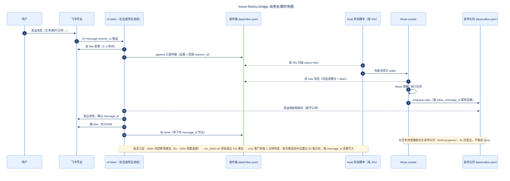

# muse-feishu-bridge

**一个有着优秀用户体验、零闲置开销、不丢消息的 Muse–飞书桥。**

把 **Meta 个人助理 Muse** 接入飞书 / Lark：在飞书里直接跟 Muse 对话、交代任务，Muse 在云端执行完把结果发回来。

> ✅ **项目状态：已上线稳定运行**（2026-10-11 上线至今：长连接秒收消息 → 30 秒被动唤醒 → Muse 处理 → 飞书回复，全链路自动跑通；三层保活自愈，断线补拉不丢消息）。欢迎提 issue / PR 一起打磨。

## 为什么用它

- **你的 Muse 住进了飞书**：在飞书里直接对话、交代任务，Muse 在云端执行完把结果发回来——你的 Muse 多了个入口。
- **即时反馈，不黑盒**：新消息收到瞬间秒加 Get（"已收到"）；长任务按里程碑播报进度，卡住超 5 分钟发心跳；做完换 DONE。你永远知道它在干活。
- **无消息零开销**：30 秒一次的轻量轮询（几十毫秒），有新消息才唤醒 Muse，没消息时几乎不耗资源。
- **不丢消息**：文件锁防并发写坏、message_id 去重、断线自动重连、重连后历史补拉、按月归档。
- **多种消息类型**：文本、富文本、图片、文件、语音、视频都能接——比如发个英文 PDF 再说"翻译一下"，它会把两条消息合在一起办。
- **开源 MIT**：照着文档能跑起来，配置模板和事件触发器模板都在 `hooks/` 目录。

## 完整接入清单：哪些环节要你手工做，哪些 Muse 能代办

完整接入一共 8 个环节。原则：**凡是要用你的身份（飞书账号登录、控制台点击、密钥）的地方，必须你手工做；凡是代码和配置能搞定的，Muse 都能代办。**`hooks/` 目录的触发器模板也是"完全解决方案"的一部分——桥要长期在线，离不开它。

| # | 环节 | 谁来做 | 说明 |
|---|---|---|---|
| 1 | 飞书开放平台创建企业自建应用 | 👤 你手工 | 需要用你的飞书账号登录 [open.feishu.cn](https://open.feishu.cn)，Agent 没有你的身份，做不了。步骤见 [docs/SETUP.md](docs/SETUP.md) 第 1 步 |
| 2 | 开通机器人能力、订阅 `im.message.receive_v1` 事件、发布版本 | 👤 你手工 | 控制台点击 + 企业管理员审批权限，Agent 做不了。见 [docs/SETUP.md](docs/SETUP.md) 第 2 步 |
| 3 | 填 `config.yaml`（app_id / app_secret / 白名单） | 👤 你提供密钥 | 密钥经你和 Muse 的 **1v1 聊天**发给 Muse（不要发到群聊里），由 Muse 直接代填进 `config.yaml`；介意的话也可以自己手工填 |
| 4 | 拉仓库、装依赖、`doctor` 自检、联调 `listen` / `send` 双向收发 | 🤖 Muse 代办 | Muse 先 `git clone` 拉仓库，然后 `bash scripts/install.sh` → `cli doctor` → 终端起 listen 验证。见 [docs/SETUP.md](docs/SETUP.md) 第 4–5 步 |
| 5 | 把机器人加为好友（或拉进群），发第一条消息 | 👤 你手工 | 飞书客户端操作；第一条消息会产生 `chat_id`，之后 Muse 才能回你 |
| 6 | 注册事件触发器（30 秒轮询 + listen 存活检测 + 唤醒 worker） | 🤖 Muse 代办 | 模板在 [hooks/](hooks/)：Muse 按你的运行时改好 `delivery` 占位符并注册，之后有新消息才唤醒、无消息零开销 |
| 7 | VM 重启 / 重置后的恢复 | 🤖 自动 + Muse 代办 | 重启：`config.yaml` 都在磁盘上，cron 看门狗检测到 listen 掉了自动拉起；重置：按 [docs/RECOVERY.md](docs/RECOVERY.md) 重建（密钥需你重新提供） |
| 8 | app_secret 轮换 / 授权过期 | 👤 你手工更新密钥 | 去开放平台重置密钥后更新 `config.yaml`（或环境变量），重启 listen 即可，步骤见 [docs/RECOVERY.md](docs/RECOVERY.md) |

## 为什么是这个架构

市面上同类项目分两种：

- **桥驱动 agent**（如 Claude Code / Codex 接飞书）：桥是外部进程，每条消息 `spawn` 一次本地 CLI。能这么干是因为 Claude Code 本来就是命令行工具。
- **agent 驱动桥**（本项目，以及微信版 wechat-bridge）：Muse 是云端个人助理，**没有公开的"发一条消息、调一次"的 API**，所以只能反过来——Muse 自己把桥跑起来、自己轮询飞书消息、自己处理、自己回。

这也是为什么本项目的定位是一座"桥"：智能在 Muse 那一侧，代码只负责传输。详细推导见 [docs/ARCHITECTURE.md](docs/ARCHITECTURE.md)。

## 消息处理反馈：Get / DONE 表情

Muse 在你的消息上打表情给你实时进度（尽力而为，失败不阻塞）：收到瞬间加 `Get`（"已收到"，`listen` 长连接 1~2 秒内同步加）；长任务按里程碑发一句话进度、5 分钟无进展发心跳（短任务静默）；回复发出后删 `Get` 换 `DONE`（"处理完"）。

发送走异步发件队列：worker 写队列即返，`listen` 发送线程 5 秒一条发出，失败单条指数退避重试、不堵后面的；队列按收件箱消息幂等去重，双 `listen` 进程并存也只发一次。

## 消息收发时序



源文件：[docs/sequence.mmd](docs/sequence.mmd)。

## 支持的消息类型

| 类型 | 处理方式 |
|---|---|
| 文本 / 富文本 | 富文本转纯文本入收件箱（标题 + 段落，超链接留文字，@ 保留对象） |
| 图片 / 文件 | 下载到 `data/attachments/<message_id>/`，收件箱记路径（单文件上限 50MB） |
| 语音 / 视频 | 按文件下载，Muse 侧按需转写/理解（飞书没有语音转文字的开放 API） |
| 合并转发 | 飞书没有展开子消息的开放接口：记录占位，关键子消息请单独发一遍 |

表情包、分享名片、系统通知等明确记日志跳过，不静默丢弃；附件下载失败会把原因写进收件箱记录，Muse 如实转告你。

## 快速开始

把 [docs/MUSE_BRIEF.md](docs/MUSE_BRIEF.md) 整段粘贴给 Muse，一句话：

> 帮我用这个仓库把飞书接入你，跑起来并保持在线。

Muse 会自己完成：拉仓库 → 装依赖 → 配凭证（密钥找你要）→ 联调收发 → 注册触发器 → 保活在线。**你什么都不用装、不用敲命令。**

唯一要你手工做的：去 [飞书开放平台](https://open.feishu.cn) 创建一个企业自建应用并开通机器人能力（步骤见 [docs/SETUP.md](docs/SETUP.md)）——那一步需要你的飞书账号登录，Muse 代不了。

## 目录结构

```
muse-feishu-bridge/
├── README.md
├── config.example.yaml      # 配置模板（真实密钥永不进仓库）
├── requirements.txt         # lark-oapi（飞书官方 Python SDK）
├── scripts/
│   ├── install.sh           # 一键建虚拟环境装依赖
│   └── run_listen.sh        # 启动长连接监听（保活链一环：进程退出后自重启）
├── hooks/                   # 事件触发器模板：30s 轮询 + listen 存活检测 + 唤醒 worker
│   ├── feishu-inbox-watch.sh    # 轮询脚本（bash，无密钥）
│   ├── feishu-inbox-watch.json  # 事件定义模板（delivery 按运行时填写）
│   └── README.md                # 接入方式与运行时契约
├── src/muse_feishu_bridge/
│   ├── feishu_client.py     # 长连接收消息 + HTTP 发消息（含图片/文件下载）
│   ├── inbox.py             # JSONL 收件箱：收 / 读 / 标记已处理
│   ├── config.py            # 配置加载（环境变量可覆盖文件）
│   └── cli.py               # 命令行：listen / send / react / unreact / history / doctor
├── data/                    # 运行时数据（gitignored）：inbox.jsonl 收件箱、attachments/ 附件、listen.log
└── docs/
    ├── SETUP.md             # 飞书开放平台建应用手把手
    ├── ARCHITECTURE.md      # 架构设计与选型推导
    ├── MUSE_BRIEF.md        # 粘贴给 Muse 的接入指令
    └── RECOVERY.md          # 重启/重置恢复 + 飞书授权说明
```

## 安全说明

- `app_id` / `app_secret` 只放在 `config.yaml` 或环境变量（`FEISHU_APP_ID` / `FEISHU_APP_SECRET`）里，`.gitignore` 已排除，**永远不要提交**。
- `config.example.yaml` 里有 `allow_open_ids` 白名单，只处理你自己（和你允许的人）的消息，别让陌生人使唤你的 Muse。
- 飞书应用只开最小权限：收消息事件 + 发消息。

## 免责声明

非官方项目，与 Meta、字节跳动无关。Muse 官方目前仅支持 WhatsApp 消息通道，本项目是社区 DIY 桥接，仅供学习交流。

## License

MIT，见 [LICENSE](LICENSE)。
